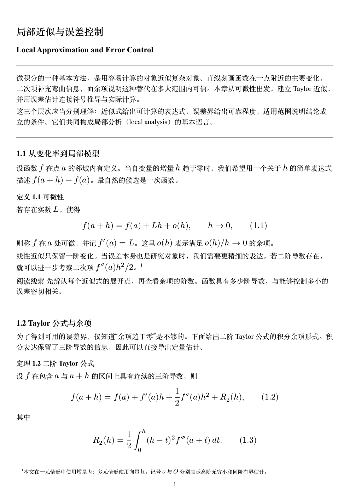
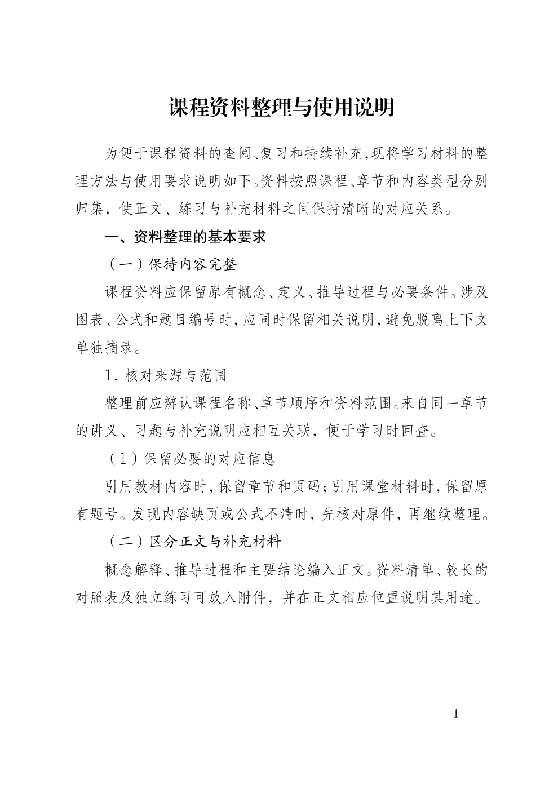

# Recto · 文档排版插件

用于课程讲解写作、数学讲义、教材和正式文字材料排版的 skills。给出课件、Markdown、正文或资料，交付 **Typst 源文件和 PDF**；需要时增加可编辑 Word。

可作为 Codex 插件安装，也可单独安装 skill。当前两个 skill、两套排版风格。生成内容时按需配图和精简文字；转换已有内容时保留原文、公式、标题和编号。开源字体直接随仓库和插件分发；首次使用先检查依赖，缺少时进入独立安装流程，完成后继续排版。

| Skill | 用途 |
|---|---|
| [`recto`](skills/recto/SKILL.md) | 通用成文与排版；已有正文忠实转换为 Typst、PDF，按需输出 Word |
| [`study-notes`](skills/study-notes/SKILL.md) | 从课件、教材和题解制作适合补课的简洁讲解；按用户主要语言写作，必要时标注材料原词和已明确的考试术语，复用 Recto 排版 |

`study-notes` 负责知识重组、例题取舍和讲解写作，依赖 `recto` 导出；不另建排版引擎。语言规则不限定中英组合，具体字体及书写方向仍须在实际成品中验证。

## 两套风格预览

下图来自当前 skill 自带样例使用原字体导出的 PDF，点击图片可查看原尺寸。缺少原字体时使用随包字体，字形和分页可能不同。

<table>
  <tr>
    <th width="50%">清爽课程讲义 · reference</th>
    <th width="50%">国标正文 · gbt9704</th>
  </tr>
  <tr>
    <td><a href="docs/recto/previews/reference.png"></a></td>
    <td><a href="docs/recto/previews/gbt9704.png"></a></td>
  </tr>
  <tr>
    <td>A4，12pt 宋体与 Times，中英文和数学混排，上下 12mm，底部居中页码。</td>
    <td>A4，三号仿宋，二号小标宋标题，国标正文边距和单双页页码；不含红头和署名。</td>
  </tr>
</table>

讲义风格适合课程笔记、数学教材和复习资料；国标风格适合正文、表格、附件／附录。完整参数见 [版式约定](skills/recto/references/styles.md)。

## 安装到 Codex

### 推荐：插件与 Marketplace

本仓库自带 Marketplace 目录。使用支持插件的 Codex CLI：

```sh
codex plugin marketplace add UserUnauthorized/Recto --ref main
codex plugin add recto@recto
```

也可在添加 Marketplace 后，打开／重启 Codex 桌面端，在插件目录选择 **Recto → 安装**。插件包含 `$recto` 和 `$study-notes`，设置引导仍由 `$recto` 负责。运行安装后的设置引导，或直接说：

```text
用 $recto 检查并配置排版环境，缺什么就安装什么。
```

已经安装过同名独立 skill 的用户，迁移前先备份并移走旧的 `recto` 技能目录，避免两个入口同时被发现。插件更新源：

```sh
codex plugin marketplace upgrade recto
```

升级源后在插件管理中更新 Recto，随后重新运行依赖检查。插件清单位于 [`plugin.json`](plugin.json)，仓库目录位于 [`.agents/plugins/marketplace.json`](.agents/plugins/marketplace.json)，设置引导复用现有 skill，不启动后台服务，也不需要 API key。

这是可通过 GitHub 添加的 Marketplace，并不代表已上架 OpenAI 公共插件目录。公共目录需另行提交插件包并通过审核，见 [官方构建文档](https://developers.openai.com/plugins/build/plugins)与[提交说明](https://developers.openai.com/plugins/deploy/submission)。

### 只安装 skill

以下终端命令适用于 macOS／Linux，需要 Git 和 Python 3.10+。不需要插件管理能力时使用此方式；两种安装方式选一种。

```sh
git clone https://github.com/UserUnauthorized/Recto.git
cd Recto
python3 -m venv .venv
source .venv/bin/activate
python -m pip install -r requirements-dev.txt
python scripts/skills.py check recto
python scripts/skills.py install recto --dest "$HOME/.agents/skills"
```

上面显式安装到 Codex 的用户技能目录 `~/.agents/skills/recto/`。安装后在 Codex 中提及 `$recto` 即可调用；未出现时重启客户端。技能目录与调用方式见 [OpenAI 官方技能文档](https://learn.chatgpt.com/docs/build-skills)。

需要课程讲解流程时，在已安装 Recto 的同一环境中追加安装：

```sh
python scripts/skills.py check study-notes
python scripts/skills.py install study-notes --dest "$HOME/.agents/skills"
```

更新它时使用相同安装目录并加 `--replace`。单独的 `study-notes-skill.zip` 只包含写作 skill，排版仍依赖 Recto；插件包同时包含两者。

**已有安装时沿用原目录。** 本仓库安装脚本未传 `--dest` 时使用 `$CODEX_HOME/skills`，未设置则使用 `~/.codex/skills`；这是已有本地安装的默认路径。若之前安装在这里，把上面及更新命令的 `--dest` 改为原目录，避免出现两份同名 skill。也可用 `--dest /path/to/skills` 指定其他技能目录。

### 更新独立 skill

在克隆的仓库目录中执行；`--dest` 必须与首次安装一致：

```sh
git pull --ff-only
source .venv/bin/activate
python -m pip install -r requirements-dev.txt
python scripts/skills.py check recto
python scripts/skills.py install recto --dest "$HOME/.agents/skills" --replace
```

内容相同则不改动。已有版本不同时，不带 `--replace` 会停止；带上后先将旧版保存到本仓库的 `output/install-backups/`，再整体更新。修改始终回到 `skills/`，然后重新安装。

## 依赖与随包字体

排版前自动走 **检查 → 只安装缺项 → 复查 → 继续原任务**。优先复用 Codex 桌面的捆绑 Python；没有桌面工具也能使用普通 Python。联网只发生在安装流程中，实际导出离线运行。检查脚本不安装、不联网：

```sh
python skills/recto/scripts/doctor.py --style reference
```

需要 Python 3.10+、Pandoc ≥3.9、Typst ≥0.15.1，以及 `python-docx`、`lxml`。缺包时在专属虚拟环境安装，不修改系统或 Codex 捆绑的 Python。完整步骤见 [依赖检查与安装](skills/recto/references/setup.md)。手动导出可在已激活的虚拟环境中运行 `python -m pip install -r skills/recto/requirements.txt`。

| 用途 | 本地原字体优先 | 缺少时随包提供 |
|---|---|---|
| 讲义中文／英文 | Songti SC、Times New Roman | Fandol 宋体、Liberation Serif |
| 国标正文／一级／二级标题 | 方正仿宋、黑体、楷体 | Fandol 仿宋、黑体、楷体 |
| 国标主标题／页码 | 方正小标宋、SimSun | Fandol 宋体粗体／常规 |
| 数学 | New Computer Modern Math；Word 优先 Cambria Math | 原样张使用的 New Computer Modern Math |

字体文件及许可证在 [`skills/recto/assets/fonts/`](skills/recto/assets/fonts/README.md)，约 37 MiB。Typst 直接读取；Word 编辑时由安装流程将随包字体装到用户字体目录。替代关系写进导出报告。Fandol 宋体粗体并非小标宋的等同替代，字体替代后仍须复核版式。专有字体不在公开仓库中分发。

只使用随包字体的实际首页：[课程讲义](docs/recto/previews/reference-bundled.png) · [国标正文](docs/recto/previews/gbt9704-bundled.png)。

## 使用方式

安装后把文件或正文交给 Codex，并说明用途和需要的格式。无需手写 Typst。

**原样转换为 PDF 和 Word：**

```text
用 $recto 把这份 Markdown 原样排成 PDF 和 Word，采用清爽课程讲义样式。
保留原文、公式和编号，同时交付 Typst 源文件。
```

**按国标正文排版：**

```text
用 $recto 的 gbt9704 样式排版这份材料，导出 PDF 和 Word。
只保留文字、表格和附录，不要红头和署名。
```

**根据资料生成内容：**

```text
用 $recto 根据这些资料写一份 Taylor 公式复习讲义，面向大学一年级学生。
采用清爽课程讲义样式，补充例题；有助于解释方法选择时加入流程图。
导出 Typst、PDF 和 Word。
```

**把课件做成适合补课的讲解文档：**

```text
用 $study-notes 根据第一章 PPT 和题解制作简洁的讲解文档，面向基础不牢的学生。
按我的主要语言写作；课件语言不同时，给需要掌握的关键词标注原词。
可以重组内容、精选和改编例题、截取有用的课件图，交付 Typst 和 PDF。
```

如果已知考试使用另一种语言，可直接补充说明；skill 不会仅凭外语课件猜测考试语言，也不固定页数、例题数或插图数。

**只改指定部分：**

```text
用 $recto 排版这份讲义，只把第 3 节改得更好懂，并给该节算法加流程图。
其他部分保持原样，导出 PDF。
```

纯转换不启用扩写、补充研究、自动配图或去 AI 腔改写；只有明确要求生成／改写的范围才启用这些步骤。默认交付 `.typ` 和 `.pdf`，要求 Word 时增加 `.docx`。

### 不通过对话，直接运行样例

在仓库根目录、激活 `.venv` 并备齐上述依赖后执行：

```sh
python skills/recto/scripts/export.py skills/recto/assets/examples/reference.md \
  --style reference --formats typ,pdf,docx --output output/recto/demo-reference

python skills/recto/scripts/export.py skills/recto/assets/examples/gbt9704.md \
  --style gbt9704 --formats typ,pdf,docx --output output/recto/demo-gbt9704
```

换成自己的 Markdown 路径即可排版。只需 Typst 与 PDF 时，将 `--formats` 改为 `typ,pdf`。输入语法、公式、图片、显式分页和附录写法见 [源文件与导出](skills/recto/references/export.md)。

输出目录包含：

| 文件 | 作用 |
|---|---|
| `document.typ` | 已内嵌样式的 Typst 源文件，可编辑、重新编译 |
| `document.pdf` | 固定版面的阅读与打印版本 |
| `document.docx` | 选择 `docx` 时生成；文字、公式和普通表格可编辑 |
| `content.md`、`assets/` | 整理资源路径后的共同源与所需图片；无图片时没有 `assets/` |
| `source-and-exports.zip` | 源文件与所选成品的完整包 |
| `fonts/`、`REBUILD.txt` | 可分发字体、许可证与重编译说明；系统专有字体不随包复制 |
| `export-report.json` | 源哈希、引擎版本、字体选择、替代关系和数学数量；不代表已完成视觉检查 |

三种输出共用 Markdown 源，不从 PDF 反转生成 Word。Word 的换行、分页和数学字体可能与 PDF 不同；国标横表在 PDF 中旋转排入纵向纸张，在 Word 中使用横向节。编译后仍需逐页检查；已有 DOCX 样张经 LibreOffice 渲染核验，原生 Microsoft Word 尚未实测。国标风格只覆盖正文相关版式，不是完整机关公文认证。

## 仓库维护

```text
skills/<name>/     可安装的 skill；唯一的正式源文件
plugin.json       Codex / Agent Plugins 插件清单
.agents/plugins/  本仓库 Marketplace 目录
scripts/skills.py  检查、打包与本地安装入口
scripts/plugin.py 插件检查与精简 ZIP 打包入口
checks/<name>/     维护者使用的行为检查场景，不随 skill 安装
docs/<name>/       设计依据、精选预览、决策与验证记录
archive/<name>/    已冻结的设计原型，不参与正式打包
output/<name>/     本地导出、渲染与试验产物，忽略版本控制
dist/             可分发安装包，忽略版本控制
```

```sh
python scripts/skills.py list
python scripts/skills.py check
python scripts/skills.py package recto  # dist/recto-skill.zip
python scripts/skills.py package study-notes  # dist/study-notes-skill.zip
python scripts/plugin.py check
python scripts/plugin.py package       # dist/recto-plugin-0.2.0.zip
python -m unittest discover -s checks/recto -p 'test_*.py'
python -m unittest discover -s checks/plugin -p 'test_*.py'
```

`check` 只检查元数据、skill 内相对链接和 Python 语法。改动导出脚本、模板或字体后，要运行真实样例并逐页检查受影响格式。精选 README 预览保存在 `docs/recto/previews/`；其余大体积渲染、转换探针与缓存留在 `output/`。必要输入样例、图片和模板随 skill 保留。

- [维护约定](AGENTS.md)、[Recto 行为场景](checks/recto/scenarios.md)与[课程讲解行为场景](checks/study-notes/scenarios.md)
- [引擎决策](docs/recto/adr/0001-typst-first.md)与[版式参数](skills/recto/references/styles.md)
- [已完成的导出验证](docs/recto/validation/2026-10-19-exports.md)
- [原型归档](archive/recto/book-styles/README.md)
