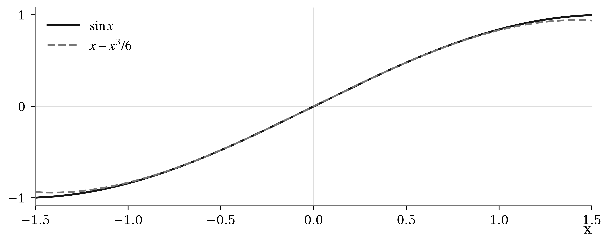

微积分的一种基本方法，是用容易计算的对象近似复杂对象。直线刻画函数在一点附近的主要变化，二次项补充弯曲信息，而余项说明这种替代在多大范围内可信。本章从可微性出发，建立 Taylor 近似，并用误差估计连接符号推导与实际计算。

这三个层次应当分别理解：**近似式**给出可计算的表达式，**误差界**给出可靠程度，**适用范围**说明结论成立的条件。它们共同构成局部分析（local analysis）的基本语言。

# 1.1 从变化率到局部模型

设函数 $f$ 在点 $a$ 的邻域内有定义。当自变量的增量 $h$ 趋于零时，我们希望用一个关于 $h$ 的简单表达式描述 $f(a+h)-f(a)$。最自然的候选是一次函数。

**定义 1.1 可微性**

若存在实数 $L$，使得

$$f(a+h)=f(a)+Lh+o(h),\qquad h\to 0,\qquad\text{(1.1)}$$

则称 $f$ 在 $a$ 处可微，并记 $f'(a)=L$。这里 $o(h)$ 表示满足 $o(h)/h\to 0$ 的余项。

线性近似只保留一阶变化。当误差本身也是研究对象时，我们需要更精细的表达。若二阶导数存在，就可以进一步考察二次项 $f''(a)h^2/2$。[^1]

**阅读线索** 先辨认每个近似式的展开点，再查看余项的阶数。函数具有多少阶导数，与能够控制多小的误差密切相关。

# 1.2 Taylor 公式与余项

为了得到可用的误差界，仅知道“余项趋于零”是不够的。下面给出二阶 Taylor 公式的积分余项形式。积分表达保留了三阶导数的信息，因此可以直接导出定量估计。

**定理 1.2 二阶 Taylor 公式**

设 $f$ 在包含 $a$ 与 $a+h$ 的区间上具有连续的三阶导数，则

$$f(a+h)=f(a)+f'(a)h+\frac{1}{2}f''(a)h^2+R_2(h),\qquad\text{(1.2)}$$

其中

$$R_2(h)=\frac{1}{2}\int_0^h(h-t)^2f'''(a+t)\,dt.\qquad\text{(1.3)}$$

若在该区间上 $\lvert f'''(x)\rvert\le M$，则 $\lvert R_2(h)\rvert\le M\lvert h\rvert^3/6$。

**证明** 令 $g(t)=f(a+t)$，对式 (1.3) 中的积分连续使用两次分部积分。记 $I=R_2(h)$，则

$$
\begin{aligned}
I&=-\frac{1}{2}h^2g''(0)+\int_0^h(h-t)g''(t)\,dt\\
&=-\frac{1}{2}h^2g''(0)-hg'(0)+\int_0^hg'(t)\,dt\\
&=g(h)-g(0)-hg'(0)-\frac{1}{2}h^2g''(0).
\end{aligned}
\qquad\text{(1.4)}
$$

移项即得式 (1.2)。当 $h\ge 0$ 时，对积分取绝对值可得 $\lvert I\rvert\le Mh^3/6$；当 $h<0$ 时交换积分上下限，同样得到 $M\lvert h\rvert^3/6$。$\square$

从证明可以看出，Taylor 多项式与原函数在展开点具有相同的函数值、一阶导数和二阶导数。余项则记录两者在离开展开点之后的差异。精度取决于步长和高阶导数，不能只凭多项式次数判断。

**例 1.3 指数函数的二阶近似**

取 $f(x)=e^x$，在 $a=0$ 处展开，得到 $e^h=1+h+h^2/2+R_2(h)$。对 $\lvert h\rvert\le 0.1$，可取 $M=e^{0.1}$，所以

$$\lvert R_2(h)\rvert\le\frac{e^{0.1}}{6}\lvert h\rvert^3<1.85\times 10^{-4}.\qquad\text{(1.5)}$$

**条件与结论** 连续三阶导数是本定理使用的充分条件。不要把这一条件误读成任何二阶近似都必须满足的必要条件。

# 1.3 误差的尺度与可视化

考虑 $\sin x$ 在原点附近的三次近似 $p_3(x)=x-x^3/6$。由于四阶项在原点处为零，对四阶 Taylor 公式使用五阶余项估计，可得

$$\lvert\sin x-p_3(x)\rvert\le\frac{\lvert x\rvert^5}{120}.\qquad\text{(1.6)}$$

图 1 展示两个函数在 $[-1.5,1.5]$ 上的形状。原点附近的曲线几乎重合；离开原点后，三次项仍有修正作用，但误差逐渐可见。图形帮助建立直觉，严格的精度保证仍来自式 (1.6)。

下表同时列出实际绝对误差与理论上界。上界不必等于实际误差，但必须在给定条件下始终有效。减小 $x$ 的绝对值，比单纯保留更多小数位更能改变近似的可靠程度。

| $x$ | 实际绝对误差 | 理论上界 $\lvert x\rvert^5/120$ |
| :---: | ---: | ---: |
| 0.25 | $8.126\times 10^{-6}$ | $8.138\times 10^{-6}$ |
| 0.50 | $2.589\times 10^{-4}$ | $2.604\times 10^{-4}$ |
| 1.00 | $8.138\times 10^{-3}$ | $8.333\times 10^{-3}$ |

: 实际误差与理论上界；实际误差以科学记数法四舍五入。

**数值判断** 若要求绝对误差不超过 $10^{-4}$，充分条件是 $\lvert x\rvert\le(120\times 10^{-4})^{1/5}$。这是从误差要求反推步长范围的基本方法。

# 1.4 多元情形与二次型

一元近似中的导数，在多元情形中分别对应梯度（gradient）与 Hessian 矩阵。设 $f:\mathbb{R}^n\to\mathbb{R}$ 在 $\mathbf{a}$ 的邻域内三阶连续可微，则

$$
\begin{aligned}
f(\mathbf{a}+\mathbf{h})&=f(\mathbf{a})+\nabla f(\mathbf{a})^T\mathbf{h}\\
&\quad+\frac{1}{2}\mathbf{h}^TH_f(\mathbf{a})\mathbf{h}+O(\lVert\mathbf{h}\rVert^3).
\end{aligned}
\qquad\text{(1.7)}
$$

这里的二次型汇集了纯二阶偏导数与混合偏导数的信息。它不仅描述沿坐标轴的弯曲，也描述不同方向之间的耦合；矩阵写法使这种结构一目了然。

**例 1.4 一个具有不同曲率方向的模型**

令 $f(x,y)=e^x\cos y$。在原点处，

$$\nabla f(0,0)=\begin{pmatrix}1\\0\end{pmatrix},\qquad H_f(0,0)=\begin{pmatrix}1&0\\0&-1\end{pmatrix}.\qquad\text{(1.8)}$$

因而 $f(x,y)=1+x+(x^2-y^2)/2+O((x^2+y^2)^{3/2})$。二次项在 $x$ 方向为正、在 $y$ 方向为负，反映了两种相反的局部弯曲趋势。

# 1.5 练习与进一步思考

1. 将 $\ln(1+x)$ 在原点处展开到二阶，并在 $\lvert x\rvert\le 1/2$ 上给出一个明确的三阶误差界。
2. 利用式 (1.6)，求一个使 $\lvert\sin x-p_3(x)\rvert\le 10^{-5}$ 成立的充分条件。比较所得范围与图中的直觉判断。
3. 计算 $f(x,y)=e^{x+y}$ 在原点处的二阶 Taylor 多项式，解释混合项 $xy$ 的来源。

**A local model is a controlled simplification.**

A Taylor polynomial captures the behaviour of a smooth function near a chosen point. The remainder determines how far the approximation can be trusted. Always read an approximation together with its assumptions and its error bound.

**本章要点** 展开点决定局部模型，导数决定多项式系数，余项决定精度。处理多元函数时，先辨认梯度与 Hessian，再讨论方向上的变化。

[^1]: 本文在一元情形中使用增量 $h$；多元情形使用向量 $\mathbf{h}$。记号 $o$ 与 $O$ 分别表示高阶无穷小和同阶有界估计。
